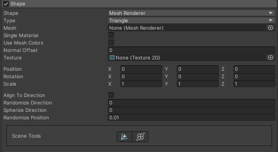

## Shape

Shapeってなんやねん  

  
↑こいつのこと

## Shape

デフォルト <code>Cone</code>  
  
**パーティクルの発生源の形状を設定するところ**  
ここを何にするかによって設定できるパラメーターが変わる
どういうパーティクルを作りたいかで何を選択するか大きく変わるらしい

以下の解説では同じ項目は省略して説明

<code>Sphere(球),Hemisphere(半球)</code>
放出方向 球の中心から外へ

Hemisphere(半球)は底面にはパーティクルが発生しない

## Radius

デフォルト <code>1(m)</code>
設定できる範囲 <code>0.0001~3.402823e+38</code>

**球の半径を設定するところ**
デフォルトの場合は半径1mが範囲になってる
0.0001にするとすべてが同じところからパーティクルが発生し始める

## Radius Thickness

デフォルト <code>1</code>
設定できる範囲 <code>0~1</code>

**パーティクル発生領域の厚みを設定するところ**

赤と黒の領域がパーティクルの発生する領域
0にすると表面のみから発生するようになる
**他の項目でもこの概念を使うのでこの概念を覚えていたほうが良い**

## 参考
[VRChatプレイヤーによるParticle System解説 ～Main Module編～](https://qiita.com/abcde_kind/items/82cddca8be2917c0bded)  
[UnityDocumantation](https://docs.unity3d.com/ja/2022.1/ScriptReference/ParticleSystem.MainModule-gravitySource.html)  
[【Unity】Particle System の「Simulation Space」](https://torisan-net.com/blog/2677)  
[パーティクルメインモジュールの全項目を映像付きで徹底解説します!［Unity］](https://walkable-2020.com/unity/particlesystem-main-module/##toc27)  
[ParticleSystemの再生の終了判定（StopAction）【Unity】](https://mackysoft.net/particlesystem-stopaction/)